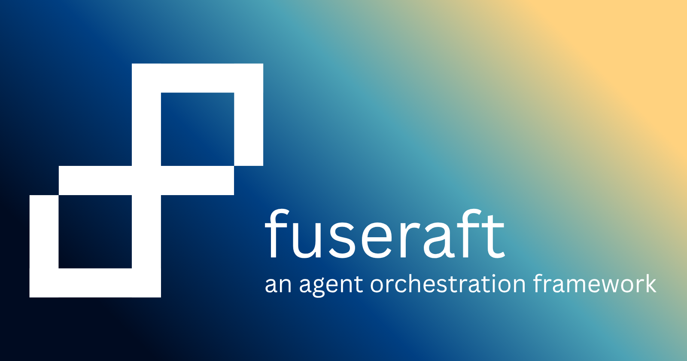

# fuseraft-server



A Blazor Server web UI for [fuseraft](https://github.com/fuseraft/fuseraft-cli) — run and watch agent orchestration sessions, chat with the fuseraft REPL, and approve what agents want to do, all from a browser.

The server doesn't link fuseraft's code. It runs the `fuseraft` CLI and speaks its versioned [wire protocol](https://github.com/fuseraft/fuseraft-cli/blob/main/docs/protocol.md): `--json` queries for lists, and JSONL event streams (`fuseraft run --bridge`, `fuseraft repl --vscode`) for live sessions. So a fuseraft upgrade can't break the server's build, and a mismatched version is reported, not misread.

---

## Features

### Sessions
Start and monitor multi-agent orchestration sessions. Each session is its own `fuseraft run --bridge` process, so several can run at once. Agent turns and tool calls stream in as they happen, and commands, file writes and agent handoffs wait for your approval. Running sessions can be cancelled, and cancelled or interrupted ones resumed. Past sessions (including ones started from the terminal) are listed with their full message history.

### Orchestration Builder
Generate an orchestration config from one of `fuseraft init`'s team templates and launch it.

- **Recent configs**: orchestrations you've run appear at the top of the template picker; pick one to start a session without generating anything
- Pick a template, a workspace, an output path and, optionally, a model (your Model Profiles are suggested) and endpoint
- The generated config is shown with its validation result; edit the files afterwards to customise agents
- Launch directly into a new session

### Model Profiles
Store model IDs, API endpoints, and API keys once — reference them from any orchestration.

- Add profiles for any provider (Anthropic, OpenAI, xAI, Google, Mistral, Ollama, …)
- API keys are stored in the OS keychain (GNOME Keyring on Linux via `secret-tool`, macOS Keychain via the `security` CLI, Windows Credential Manager via DPAPI) with a mode-600 plain-text fallback at `~/.fuseraft/profile-keys/`
- On startup, each profile's key is injected as `FUSERAFT_PROFILE_{id}_KEY` so the orchestrator resolves it automatically via `apiKeyEnvVar:` in the YAML
- Non-secret fields (name, model ID, endpoint, provider) are persisted to `~/.fuseraft/model-profiles.json`

### Plugins
Browse every registered plugin and its functions — name, description, and full function list — with a live search that filters across plugins and individual function descriptions.

### Context
Attach reference documents to a workspace. Imported files are indexed in `.fuseraft/context/` and injected into agent context at session start.

### Configs
List and validate orchestration configs with `fuseraft validate`, so the checks are the CLI's own. The panel shows agent names, selection type, and every issue found.

### Daemons
Attach to a running `fuseraft serve`, on this machine or another, over its attach WebSocket. Send it tasks, see your tasks' results, follow every task's live progress (including tasks other clients and the daemon itself started), and answer approvals for the tasks you sent, here or on the HITL page. A connection runs one of your tasks at a time, as `fuseraft attach` does.

Add daemons on the page (kept until the server stops), or list them in `appsettings.json`:

```json
"Fuseraft": {
  "Daemons": [
    { "Name": "build-box", "Url": "ws://build-box.lan:24601/attach" }
  ]
}
```

Set a daemon's token with an environment variable rather than in the file: `Fuseraft__Daemons__0__Token=<the daemon's FUSERAFT_SERVE_TOKEN>`. Anyone who can open this server can send tasks to its daemons and approve their commands, so don't expose the server more widely than the daemons themselves.

### Schedule
Add, enable, disable and remove `fuseraft schedule` jobs. Jobs run when `fuseraft schedule run` is ticked by cron or a timer. **Run** starts a job now as a live session with approvals, and doesn't change its schedule.

### Memory
Browse and delete the memories the REPL and agents keep across sessions.

### REPL
An interactive chat interface backed by the fuseraft CLI REPL — the same engine that powers the VS Code extension and the `fuseraft repl` terminal command.

- Select any configured **Model Profile** and a **workspace** to start a session; API keys are injected automatically from the profile store, and the chat's tools are confined to the workspace
- Full slash-command support (`/help`, `/clear`, `/compact`, `/plan`, `/execute`, `/system`, `/safe-mode`, and all other built-in commands) — handled natively by the CLI process, not re-implemented in the server
- Tool use enabled by default: FileSystem, Shell, Search, Git, and Http tools are available to the model, and file writes and commands ask for approval in the chat (and on the HITL page) first
- Streaming tokens and tool-call badges update in real-time as the model responds
- Assistant responses are rendered as Markdown (code blocks, tables, lists, etc.)
- Sessions are persisted to `~/.fuseraft/repl-sessions/` after each turn; past sessions appear in the **Recent Sessions** table and can be resumed at any time
- Internally the server spawns `fuseraft repl --vscode --no-banner` and speaks the same JSON-line protocol (`ready`, `token`, `tool_call`, `message_end`, `plan`, `step_status`, `session_end`, …) used by the VS Code extension

### HITL (Human-in-the-Loop)
Every approval a session, REPL chat or daemon task is waiting on, in one place, with a badge count in the nav. Shell commands show the command, file writes show a diff, and agent handoffs show who hands off to whom. Approve or deny, and the waiting process carries on. The same cards also appear on the session's page and in the REPL chat.

---

## Ecosystem Tools

### vsl (Vessel)
Vessel (vsl) - Mini Autonomous Software Engineering Agent (Phase 1).

**Purpose**: CLI tool for repository analysis and implementation planning using LangGraph orchestration. Complementary to fuseraft for automated SE workflows.

**Tech Stack**:
- Python 3.14, LangGraph, langchain-openai (xAI grok-4.3), Typer, pytest, uv
- State in `.vsl/` JSON

**CLI Commands** (Phase 1):
```bash
vsl analyze --repo ./sample-repo  # Analyze repo; writes .vsl/analysis.json
vsl plan --repo ./sample-repo --task "Add Redis caching to the customer lookup API"  # Generate plan; writes .vsl/plan.json
```

See `../vsl/` (task.md, pyproject.toml, vsl/ package) for source and full spec. Uses XAI_API_KEY env var. No direct runtime integration with fuseraft-cli yet.

---

## Requirements

- [.NET 10 SDK](https://dotnet.microsoft.com/download)
- The `fuseraft` CLI, speaking wire protocol version 1 and new enough to have `fuseraft run --bridge` and `fuseraft validate --json`. The Daemons page needs daemons new enough to serve the attach WebSocket (`fuseraft attach --url`). It's found on `PATH`; set `Fuseraft:Binary` in `appsettings.json` (or the `Fuseraft__Binary` environment variable) to use another one.
- Linux: `secret-tool` (from `libsecret-tools`) for keychain storage, or keys fall back to plain-text

---

## Running

```bash
dotnet run --project fuseraft-server/FuseraftServer.csproj
```

Tests:

```bash
dotnet test fuseraft-server/tests/FuseraftServer.Tests
```

Then open [http://localhost:5000](http://localhost:5000).

The project ships with a `Properties/launchSettings.json` that sets `ASPNETCORE_ENVIRONMENT=Development`, which is required for Blazor's static web assets (including `blazor.web.js`) to be served correctly.

---

## License

MIT — see [LICENSE](LICENSE).
