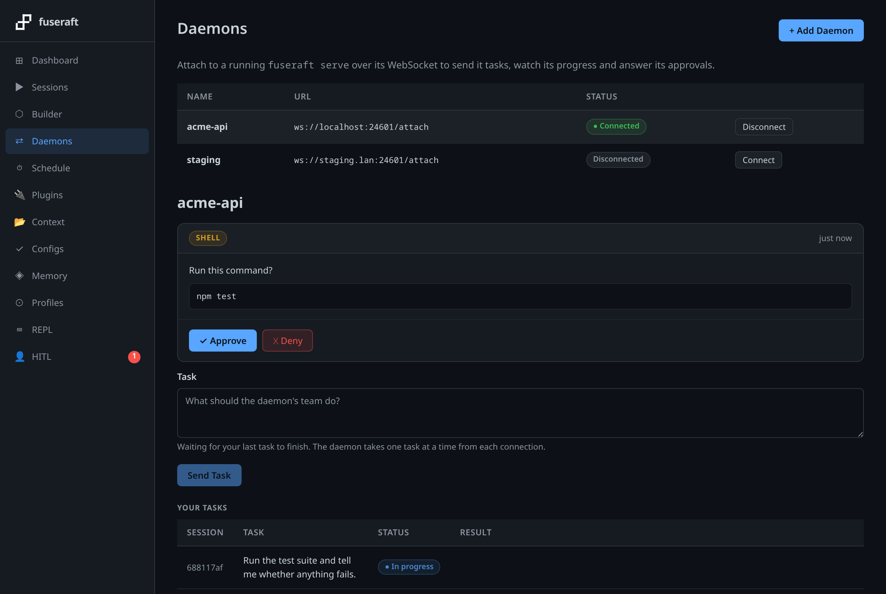

# fuseraft-web


A web UI for [fuseraft](https://github.com/fuseraft/fuseraft-cli). Run and watch agent orchestration sessions, chat with the fuseraft REPL, and approve what agents want to do, from a browser, with an account per person.

**Documentation: [fuseraft.ai/fuseraft-web](https://fuseraft.ai/fuseraft-web/)**

fuseraft-web doesn't link fuseraft's code. It runs the `fuseraft` CLI and speaks its versioned [wire protocol](https://github.com/fuseraft/fuseraft-cli/blob/main/docs/protocol.md): `--json` queries for lists, and JSONL event streams (`fuseraft run --bridge`, `fuseraft repl --vscode`) for live sessions. A fuseraft upgrade can't break its build, and a mismatched version is reported, not misread.

---

## Quick start

1. Install the [`fuseraft` CLI](https://github.com/fuseraft/fuseraft-cli/releases), v1.13.0 or later.
2. Download the archive for your platform from [Releases](https://github.com/fuseraft/fuseraft-web/releases), unpack it, and run `./fuseraft-web` (`fuseraft-web.exe` on Windows).
3. The log prints a one-time setup link:

   ```
   There are no accounts yet. Create the first admin at http://localhost:5000/setup?code=…
   ```

   Open it and create the first admin. Or create it from a shell: `./fuseraft-web users add <name> --admin`.

It listens on `http://localhost:5000`, so only this machine can reach it until you [expose it deliberately](https://fuseraft.ai/fuseraft-web/deploy/service/).

---

## What it does



- **Accounts.** Local passwords, [single sign-on](https://fuseraft.ai/fuseraft-web/guides/single-sign-on/) with any OpenID Connect provider, or both. Each account has its own fuseraft home, so its sessions, chats, memory, schedule and model profiles are its own. Read the [trust model](https://fuseraft.ai/fuseraft-web/guides/accounts/#users-and-admins) before sharing a server.
- **[Sessions](https://fuseraft.ai/fuseraft-web/guides/sessions/).** Start multi-agent orchestration sessions, or generate one with the Orchestration Builder, and watch every turn and tool call stream in. Cancel and resume them.
- **[REPL](https://fuseraft.ai/fuseraft-web/guides/repl/).** Chat with the same engine as `fuseraft repl`, confined to a workspace, with saved chats.
- **[Approvals](https://fuseraft.ai/fuseraft-web/guides/approvals/).** Every command, file write and handoff your sessions, chats and daemon tasks wait on, in one place.
- **[Daemons](https://fuseraft.ai/fuseraft-web/guides/daemons/).** Attach to `fuseraft serve` on other machines over TLS, send it tasks and answer their approvals. Admins choose who may use each daemon.
- **[Restarts don't end work](https://fuseraft.ai/fuseraft-web/deploy/restarts/).** Sessions and chats run in relay processes that outlive the server.
- **[Model profiles, schedule, plugins, context, configs and memory](https://fuseraft.ai/fuseraft-web/guides/more/).**

To serve a team, run it [as a service](https://fuseraft.ai/fuseraft-web/deploy/service/) behind a [TLS reverse proxy](https://fuseraft.ai/fuseraft-web/deploy/reverse-proxy/). Every setting is in [Configuration](https://fuseraft.ai/fuseraft-web/reference/config/).

---

## Building

Release archives are self-contained. Building from source needs the [.NET 10 SDK](https://dotnet.microsoft.com/download).

```bash
./build.sh                      # build + test
./build.sh publish              # framework-dependent build in artifacts/publish/portable/
./build.sh publish linux-x64    # self-contained single binary in artifacts/publish/linux-x64/
./build.sh pack linux-x64       # …and archived as artifacts/fuseraft-web-<version>-linux-x64.tar.gz
```

On Windows, `.\build.ps1` takes the same targets. The version comes from the latest `v*` git tag. CI builds and tests on Linux, macOS and Windows; pushing a `v*` tag publishes a GitHub release with archives for linux-x64, linux-arm64, osx-x64, osx-arm64 and win-x64.

To run from source, `dotnet run` (with `ASPNETCORE_ENVIRONMENT=Development` from `Properties/launchSettings.json`).

The docs site is in `docs/`: `npm ci && npm run dev` there to preview it.

---

## License

MIT — see [LICENSE](LICENSE).
